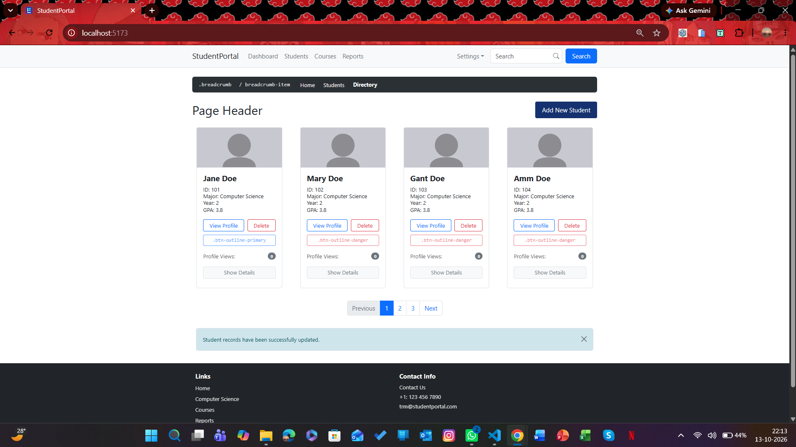
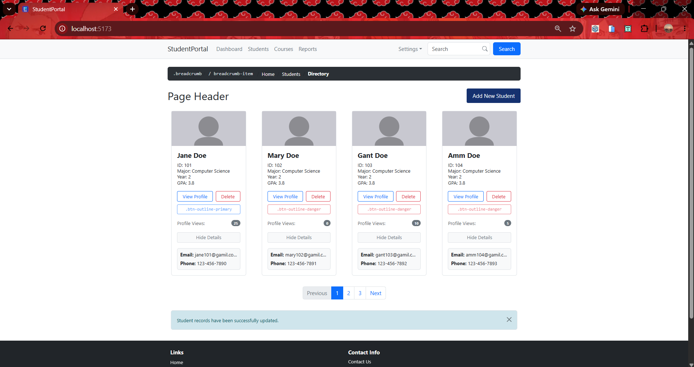

# Student Directory
-blue)


A Student Directory UI built with **React** (components, props, and hooks (use effect)) and **Bootstrap 5**, cloned from a provided reference design.

## 📸 Screenshot




## ✨ Features

* **Navbar:** Includes links, a Settings dropdown menu, and a functional search bar.
* **Breadcrumb:** Provides easy, clean secondary navigation.
* **Page Header:** Features an "Add New Student" action button.
* **Student Cards:** A responsive grid system built from a reusable `StudentCard` component using props.
* **Pagination:** Interactive bottom pagination for switching between data pages.
* **Alert Message:** A dismissible alert banner at the top of the interface.
* **Footer:** Contains quick navigation links and essential contact information.

## 💡 Core Concepts Applied

* **Components:** Modularized layout building blocks broken down into isolated, reusable pieces of code (`StudentCard`, `AppNavbar`, etc.).
* **Props:** Facilitated dynamic text and state injection across student templates to scale content cleanly.
* **Hooks (useEffect):** Utilized to monitor state life-cycles, handle component side-effects, or synchronize API/mock data accurately on mount.

## 🛠️ Tech Stack

* **React** (Vite)
* **Bootstrap 5**

## 📂 Project Structure

```text
src/
├── App.css
├── App.jsx
├── main.jsx
└── components/
    ├── AppNavbar.jsx
    ├── AppBreadcrumb.jsx
    ├── StudentCard.jsx
    ├── AppPagination.jsx
    ├── AlertMessage.jsx
    └── Footer.jsx
```

## 🚀 Run Locally

Clone the project down to your local machine and run the development environment:

```bash
# Clone the repository
git clone https://github.com/PrinkleMahshwari/student-directory.git

# Navigate into the project directory
cd student-directory

# Install dependencies
npm install

# Start the local development server
npm run dev
```

Once started, open the local URL shown in your terminal (usually `http://localhost:5173`).

## ✍️ Author

* **GitHub:** [@PrinkleMahshwari](https://github.com/PrinkleMahshwari)
